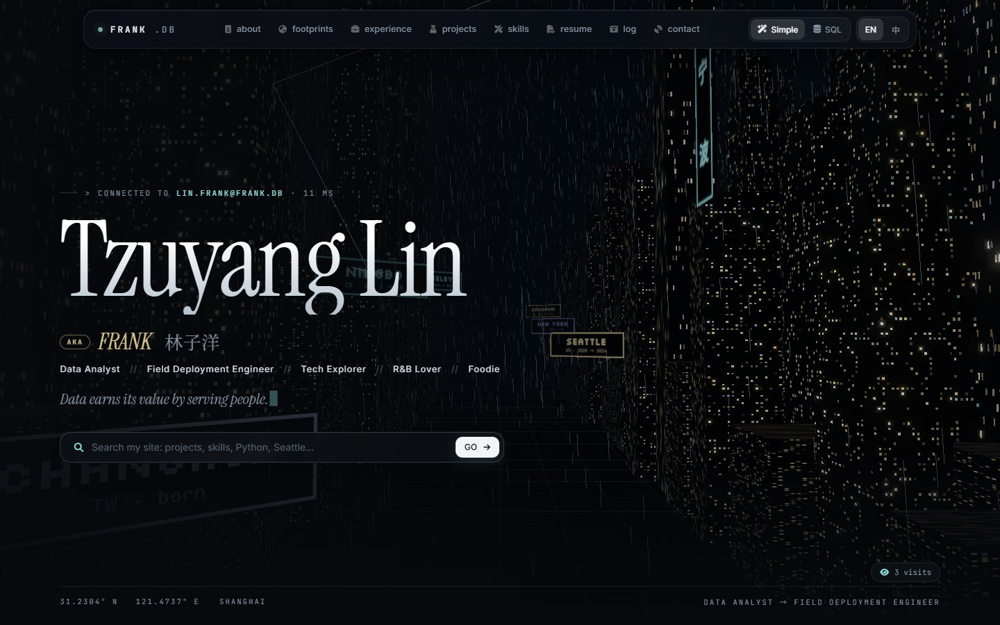
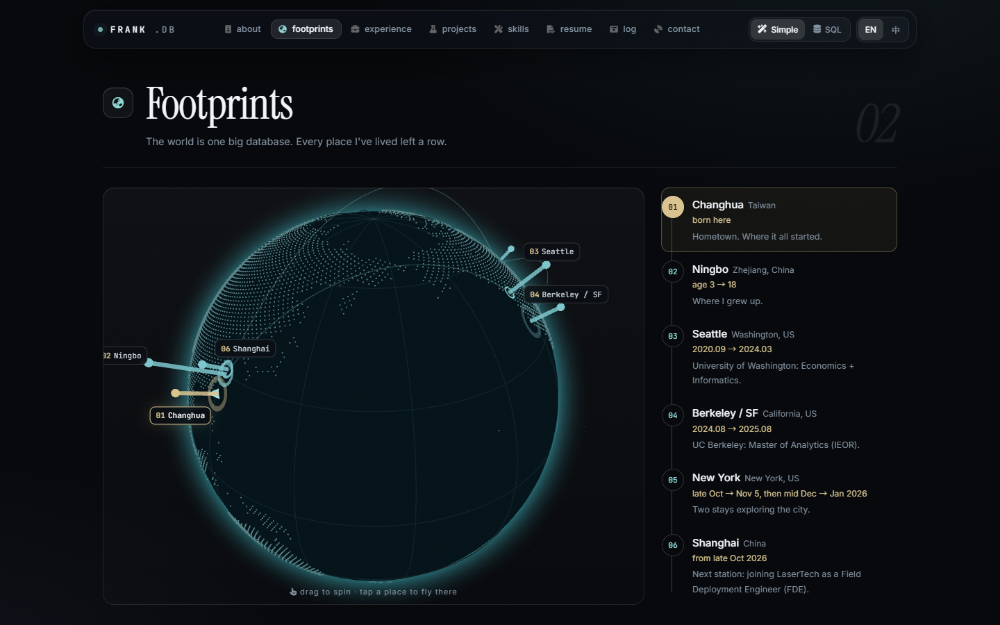
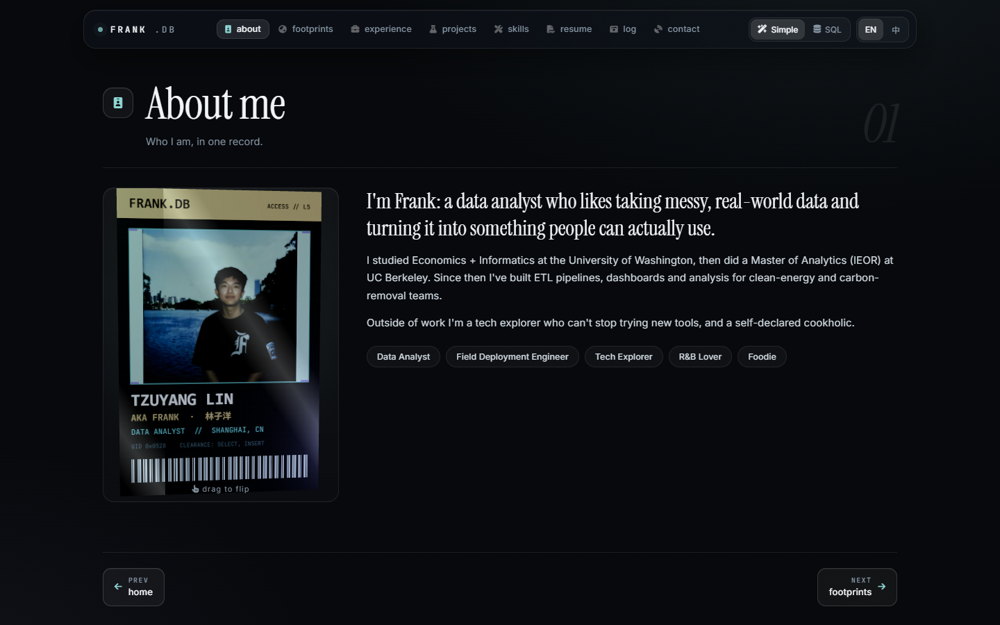
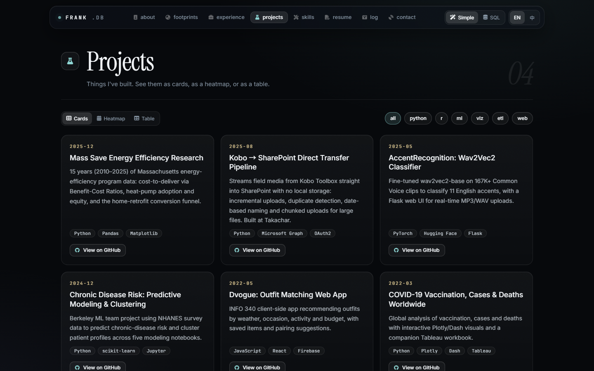
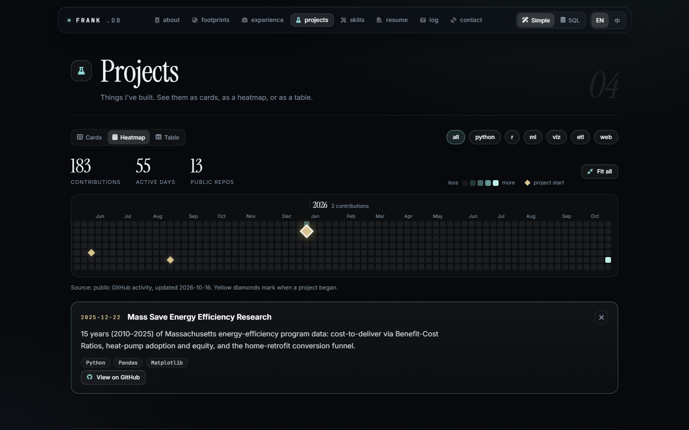
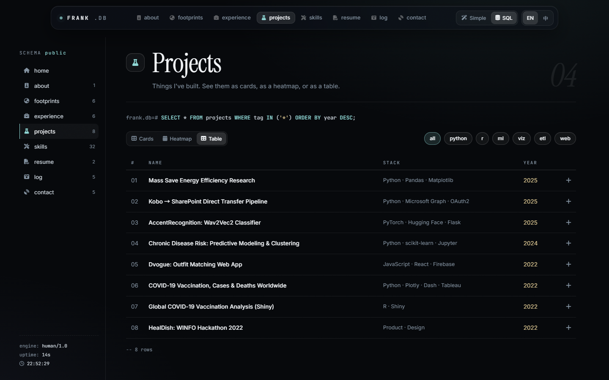
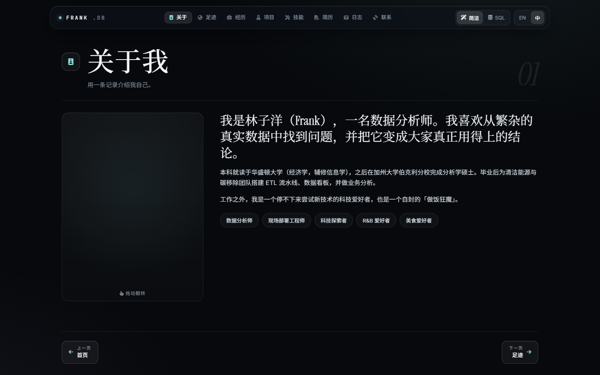
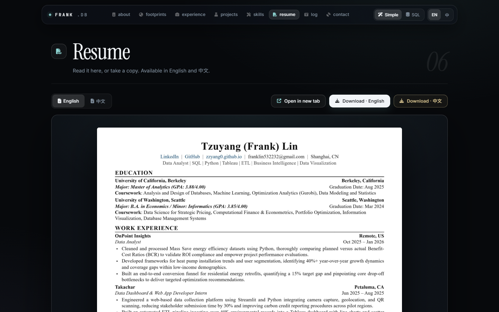
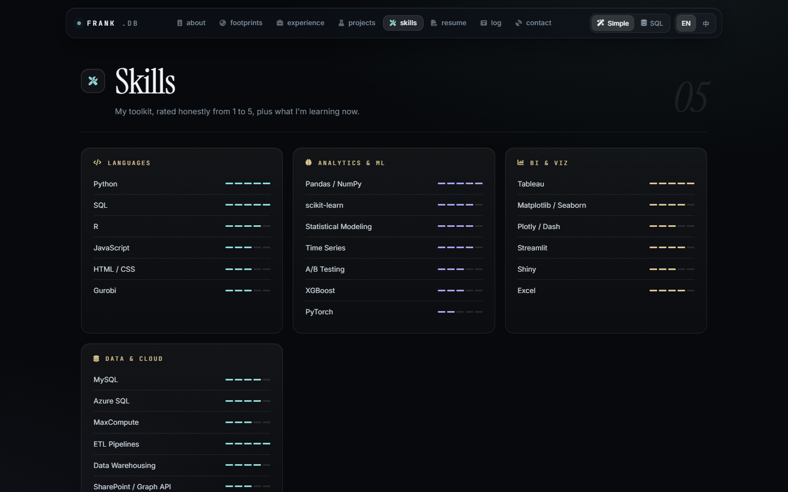

<div align="center">

# FRANK.DB

**A personal portfolio that works like a database.**<br>
Tzuyang (Frank) Lin · 林子洋 · data analyst & field deployment engineer

[**Live site → zzyang0.github.io**](https://zzyang0.github.io) · [LinkedIn](https://www.linkedin.com/in/tzuyang-frank-lin-982b56225/) · [Instagram](https://www.instagram.com/zzyang0528/)




</div>

## What is this?

Everything I've done is a row in some table, so the site is built like one: a 3D dusk-lit city whose signs are the places I've lived, a SQL console, and a globe that flies a paper plane through my life so far. The look is deliberately quiet and precise: graphite surfaces, hairline borders, serif display type and one aqua accent.

| | |
|---|---|
|  |  |
| **Footprints**: a 3D globe with a pillar on every city I've lived in (Changhua → Ningbo → Seattle → Berkeley → New York → Shanghai). | **About**: a draggable 3D access badge. |
|  |  |
| **Projects as cards**, filterable by topic. | **Heatmap**: all my public GitHub contributions in one strip, with a diamond where each project began. |
|  |  |
|  |  |
| **SQL view**: the same content as queries and tables. | **中文**: the whole site in Chinese, one click. |

## Features

- **Two ways to browse.** *Simple* (cards, plain words) or *SQL* (queries, tables, schema sidebar). The home search box is a site search in Simple view and a read-only SQL console in SQL view (`SHOW TABLES;`, `SELECT * FROM projects WHERE year >= 2024;` …) with command suggestions.
- **Bilingual.** English and 中文, with a one-click switch; search understands both.
- **Three.js scenes.** Rain-soaked city hero, interactive globe, 3D badge. Falls back gracefully if WebGL is unavailable.
- **Projects, three ways.** Cards, GitHub-style heatmap, SQL table. Only projects published on GitHub are listed.
- **Now learning.** An ongoing-skills panel next to the rated skills.
- **Personal log.** Photos and Markdown posts (English + Chinese).
- **Anonymous visit counter** (local backend or GoatCounter), no cookies, no IP addresses stored.
- **No build step.** Plain HTML, CSS and ES modules. Three.js, Font Awesome and Google Fonts load from CDNs.

## Project structure

```
index.html            page shell (all sections)
css/style.css         theme, components, both views
js/data.js            ALL content: profile, experience, projects, skills, footprints, log
js/i18n.js            interface text in English and Chinese + language switch
js/main.js            routing, rendering, search, SQL console, events
js/sql.js             the tiny read-only SQL engine
js/search.js          site search index
js/viz.js             contribution heatmap
js/city.js globe.js card.js plane.js loader.js   Three.js scenes and the loading screen
js/track.js config.js visit counter + settings
data/github.json     GitHub contribution snapshot (refresh with update-github.ps1)
log/                  Markdown posts (en + zh)
assets/               photos
serve.ps1             local server with the visit-counter backend (Windows PowerShell)
update-github.ps1     refreshes data/github.json from public GitHub data
stats.html            local visitor dashboard (needs serve.ps1)
```

## Run it locally

Opening `index.html` directly won't work (ES modules need a server). On Windows:

```powershell
powershell -ExecutionPolicy Bypass -File serve.ps1
```

then open <http://localhost:5173>. Any static server works too, for example `python -m http.server`.

Handy links: `?mode=sql`, `?lang=zh`, `?pv=heatmap`, `#projects`.

## Editing the content

Almost everything is in [`js/data.js`](js/data.js). Bilingual fields are `{ en: "...", zh: "..." }`. Interface strings live in [`js/i18n.js`](js/i18n.js). To add a log post, drop a Markdown file in `log/` (plus a `.zh.md`) and add an entry to `log` in `data.js`.

Refresh the heatmap with the latest contributions:

```powershell
powershell -ExecutionPolicy Bypass -File update-github.ps1
```

## Privacy note

The resume viewer uses redacted PDFs (no phone number) in `assets/resume-public/`, built from `tools/resume/*.html` with `tools/build-resume.ps1` (`showResume: true` in [`js/config.js`](js/config.js)). The original resumes and diploma scans are deliberately **not** in this repository: they are git-ignored and the live site shows "available on request" for the diplomas (`showPrivateDocs: false`).

## License

Code: MIT. The text, photos and images (everything in `assets/`, `log/`, `docs/` and `js/data.js`) are all rights reserved. See [LICENSE](LICENSE).
